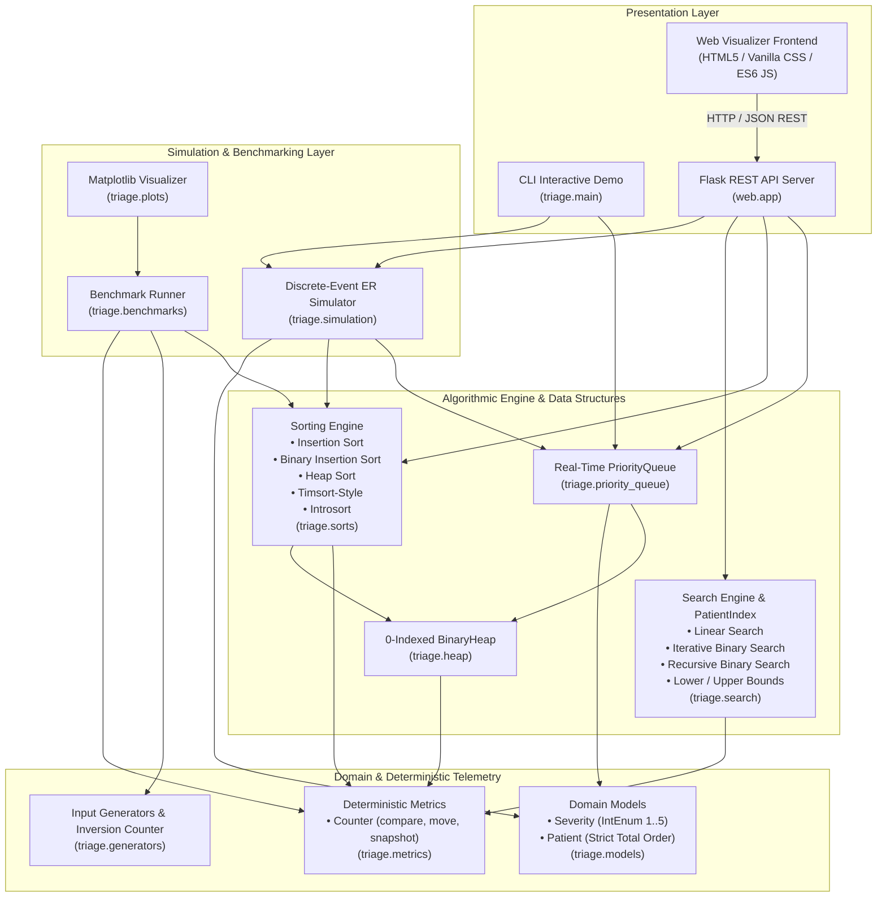

# 🏥 Hospital / Emergency Room (ER) Triage Queue & Algorithmic Analysis System
**Analysis of Algorithms (AOA) Comprehensive Research & Engineering Project**  
*Python 3.11+ • Standard Library Implementation • Flask Web Dashboard • Matplotlib Visualizations • 317 Pytest Tests*

---

## 📋 Table of Contents
1. [Executive Summary & Problem Statement](#1-executive-summary--problem-statement)
2. [High-Level System Architecture](#2-high-level-system-architecture)
3. [Algorithmic Taxonomy & Complexity Matrix](#3-algorithmic-taxonomy--complexity-matrix)
4. [Theoretical Foundations & Mathematical Proofs](#4-theoretical-foundations--mathematical-proofs)
   - [4.1. Shifts Strictly Equal Inversions ($y = x$)](#41-shifts-strictly-equal-inversions-y--x)
   - [4.2. Floyd's Bottom-Up Heap Construction ($O(n)$ Proof)](#42-floyds-bottom-up-heap-construction-on-proof)
   - [4.3. Master Theorem Binary Search Recurrence](#43-master-theorem-binary-search-recurrence)
   - [4.4. Break-Even Analysis: Pre-Sorting vs. Linear Scanning](#44-break-even-analysis-pre-sorting-vs-linear-scanning)
   - [4.5. Hole-Style Sifting Write Optimization ($d+1$ vs $3d$)](#45-hole-style-sifting-write-optimization-d1-vs-3d)
   - [4.6. Strict Total Order & Stability Invariance](#46-strict-total-order--stability-invariance)
5. [Core Subsystems & Module Breakdown](#5-core-subsystems--module-breakdown)
   - [5.1. Domain Model (`triage.models`)](#51-domain-model-triagemodels)
   - [5.2. Deterministic Performance Counter (`triage.metrics`)](#52-deterministic-performance-counter-triagemetrics)
   - [5.3. Binary Heap & Priority Queue (`triage.heap`, `triage.priority_queue`)](#53-binary-heap--priority-queue-triageheap-triagepriority_queue)
   - [5.4. Algorithmic Sorting Engine (`triage.sorts`)](#54-algorithmic-sorting-engine-triagesorts)
   - [5.5. Search Catalog & Indexing (`triage.search`)](#55-search-catalog--indexing-triagesearch)
   - [5.6. Discrete-Event ER Simulation (`triage.simulation`)](#56-discrete-event-er-simulation-triagesimulation)
   - [5.7. Seeded Input Generators (`triage.generators`)](#57-seeded-input-generators-triagegenerators)
6. [Interactive Web Dashboard & REST API (`web/`)](#6-interactive-web-dashboard--rest-api-web)
   - [6.1. Web Visualizer Features](#61-web-visualizer-features)
   - [6.2. REST API Specification](#62-rest-api-specification)
7. [Empirical Benchmarks & Experimental Findings](#7-empirical-benchmarks--experimental-findings)
   - [7.1. Wall-Clock Scaling & Comparison Counts](#71-wall-clock-scaling--comparison-counts)
   - [7.2. Empirical Crossover Dynamics ($n \approx 32 - 48$)](#72-empirical-crossover-dynamics-n-approx-32---48)
   - [7.3. Introsort Partition Cutoff Optimization ($T=16$)](#73-introsort-partition-cutoff-optimization-t16)
   - [7.4. ER Simulation Outcomes: Priority Queue vs. Batch Sort](#74-er-simulation-outcomes-priority-queue-vs-batch-sort)
8. [Repository Directory Structure](#8-repository-directory-structure)
9. [Installation & Getting Started](#9-installation--getting-started)
10. [Execution & Operational Guide](#10-execution--operational-guide)
    - [10.1. Running the Automated Test Suite](#101-running-the-automated-test-suite)
    - [10.2. Running the Interactive CLI Demo](#102-running-the-interactive-cli-demo)
    - [10.3. Launching the Web Application](#103-launching-the-web-application)
    - [10.4. Running the Benchmark Suite](#104-running-the-benchmark-suite)
    - [10.5. Generating Publication-Quality Plots](#105-generating-publication-quality-plots)
11. [Academic Viva Voce Q&A Reference](#11-academic-viva-voce-qa-reference)
12. [Verification & Test Results Summary](#12-verification--test-results-summary)

---

## 1. Executive Summary & Problem Statement

In hospital Emergency Departments (EDs), patients arrive stochastically with acute conditions ranging from non-urgent lacerations to cardiac arrests. Medical professionals triage patients using formalized clinical acuity systems such as the **Emergency Severity Index (ESI)** and the **Manchester Triage System (MTS)**.

### Core Challenges
1. **Dynamic Prioritization**: The most critically ill patients must be evaluated and treated first, preempting less urgent patients regardless of arrival time.
2. **Deterministic FIFO Tie-Breaking**: When multiple patients present with identical clinical urgency, ties must be resolved strictly in First-In, First-Out (FIFO) arrival order to eliminate human bias and maintain equity.
3. **Starvation Prevention via Dynamic Aging**: In high-load triage environments, a steady influx of high-acuity patients can cause lower-acuity patients to starve indefinitely. The system must dynamically age and escalate long-waiting patients without destabilizing queue invariants.
4. **Sub-linear Dynamic Re-Triaging**: If a waiting patient deteriorates (e.g., from *Urgent* to *Critical*), locating and promoting their priority must execute in $O(\log n)$ rather than an unacceptable $O(n)$ full queue scan.
5. **Algorithmic Rigor**: All algorithms (sorting, binary heap, priority queue, binary search variants, and hybrids) are implemented strictly from scratch without external black-box libraries and instrumented with deterministic cycle-by-cycle comparison and memory-write accounting.

---

## 2. High-Level System Architecture

The architecture is organized into four cleanly decoupled layers: **Domain & Core**, **Algorithmic & Data Structures**, **Simulation & Benchmarking**, and **Presentation (CLI & Web)**.



### Architectural Layer Responsibilities

| Layer | Module(s) | Primary Purpose |
| :--- | :--- | :--- |
| **Domain Model** | [`triage.models`](file:///c:/Users/Lenovo/OneDrive/Documents/AOA_Hospital_Triage_Project/triage/models.py) | Defines `Severity` (levels 1–5) and `Patient` dataclass with composite total ordering `key = (severity, arrival_seq)`. |
| **Deterministic Telemetry** | [`triage.metrics`](file:///c:/Users/Lenovo/OneDrive/Documents/AOA_Hospital_Triage_Project/triage/metrics.py) | `Counter` tracking exact comparison counts and physical memory writes (hole-style move convention) with zero heuristic guessing. |
| **Data Structures** | [`triage.heap`](file:///c:/Users/Lenovo/OneDrive/Documents/AOA_Hospital_Triage_Project/triage/heap.py), [`triage.priority_queue`](file:///c:/Users/Lenovo/OneDrive/Documents/AOA_Hospital_Triage_Project/triage/priority_queue.py) | 0-indexed array binary min/max-heap with hole-style sifting; priority queue maintaining an $O(1)$ ID-to-index map for $O(\log n)$ dynamic urgency updates. |
| **Sorting Engine** | [`triage.sorts`](file:///c:/Users/Lenovo/OneDrive/Documents/AOA_Hospital_Triage_Project/triage/sorts/) | Linear & binary insertion sort, in-place heap sort via Floyd's linear heapify, Timsort-style hybrid (natural runs + binary insertion + stack merge), and Introsort (median-of-three Lomuto + heap sort depth fallback + insertion cutoff). |
| **Search Engine** | [`triage.search`](file:///c:/Users/Lenovo/OneDrive/Documents/AOA_Hospital_Triage_Project/triage/search.py) | Iterative binary search with deferred equality, recursive binary search, linear search, bounds, `PatientIndex` catalog, and break-even derivation. |
| **Simulation** | [`triage.simulation`](file:///c:/Users/Lenovo/OneDrive/Documents/AOA_Hospital_Triage_Project/triage/simulation.py) | Seeded discrete-event ER simulation with Poisson arrival process, multi-doctor capacity, clinical treatment durations, and dynamic anti-starvation aging. |
| **Benchmarks & Plots** | [`triage.benchmarks`](file:///c:/Users/Lenovo/OneDrive/Documents/AOA_Hospital_Triage_Project/triage/benchmarks.py), [`triage.plots`](file:///c:/Users/Lenovo/OneDrive/Documents/AOA_Hospital_Triage_Project/triage/plots.py) | Automated empirical sweeps generating CSV data in `report/data/` and 200-dpi publication figures in `report/figures/`. |
| **Interactive Web UI** | [`web.app`](file:///c:/Users/Lenovo/OneDrive/Documents/AOA_Hospital_Triage_Project/web/app.py), [`web/static/`](file:///c:/Users/Lenovo/OneDrive/Documents/AOA_Hospital_Triage_Project/web/static/) | Flask server and glassmorphism web dashboard featuring interactive binary heap visualizer, sorting arena, search comparator, and ER simulator. |

---

## 3. Algorithmic Taxonomy & Complexity Matrix

All algorithms were analyzed analytically and verified empirically across 6 distinct input distributions (Random, Sorted, Reverse, Nearly Sorted, Few Unique, ER Mix).

| Algorithm | Best Time | Average Time | Worst Time | Auxiliary Space | Stable? | In-Place? | Key Architectural Mechanism |
| :--- | :---: | :---: | :---: | :---: | :---: | :---: | :--- |
| **Insertion Sort** | $\Omega(n)$ | $\Theta(n^2)$ | $O(n^2)$ | $O(1)$ | **YES** | **YES** | Adaptive loop: shifts element right only if inverted. Best for $n < 32$ or $I \ll n$. |
| **Binary Insertion Sort** | $\Theta(n \log n)$ | $\Theta(n^2)$ | $O(n^2)$ | $O(1)$ | **YES** | **YES** | Binary search for insertion position. Reduces comparisons to $O(n \log n)$; writes remain $O(n^2)$. |
| **Heap Sort** | $\Theta(n \log n)$ | $\Theta(n \log n)$ | $\Theta(n \log n)$ | $O(1)$ | **NO\*** | **YES** | Floyd's bottom-up $O(n)$ max-heap construction + $n-1$ extractions. Guaranteed $O(n \log n)$ upper bound. |
| **Timsort-Style Hybrid** | $\Omega(n)$ | $\Theta(n \log n)$ | $O(n \log n)$ | $O(n)$ | **YES** | **NO** | Natural run identification, descending run reversal in $O(n)$, binary insertion run extension, stack merge. |
| **Introsort Hybrid** | $\Omega(n \log n)$ | $\Theta(n \log n)$ | $O(n \log n)$ | $O(\log n)$ | **NO\*** | **YES** | Median-of-three Lomuto partition; depth limit $2\lfloor\log_2 n\rfloor$ fallback to Heap Sort; cutoff $T \le 16$ to Insertion Sort. |
| **Binary Search (Iterative)** | $\Theta(1)$ | $\Theta(\log n)$ | $O(\log n)$ | $O(1)$ | N/A | **YES** | Deferred equality testing. Exactly $\lfloor\log_2 n\rfloor + 1$ comparisons on powers of 2. |
| **Priority Queue (Min-Heap)** | $\Theta(1)$ peek | $\Theta(\log n)$ push/pop | $O(\log n)$ push/pop | $O(n)$ | **YES\*** | N/A | 0-indexed binary heap + synchronized ID-to-index hash map for $O(\log n)$ `update_severity`. |

*\*Note on Stability*: While standard Heap Sort and Introsort are not stable, the patient composite key `key = (severity, arrival_seq)` eliminates ties completely. Under a strict total order, stability becomes invariant—every sorting algorithm generates identical deterministic output.

---

## 4. Theoretical Foundations & Mathematical Proofs

### 4.1. Shifts Strictly Equal Inversions ($y = x$)

Let $arr[0..n-1]$ be an array with $I$ inversions, where an inversion is defined as:
$$\text{Inv}(arr) = \{(i, j) \mid 0 \le i < j < n \text{ and } arr[i] > arr[j]\}$$

In our hole-style insertion sort convention:
1. **Shifts**: Each rightward shift `arr[j + 1] = arr[j]` decrements the number of inversions by exactly 1. When the algorithm terminates, the array has 0 inversions. Hence, the total number of shifts across all outer loop iterations is strictly equal to $I$:
   $$\text{Shifts} = I$$
2. **Placements**: Each outer iteration $i \in [1, n-1]$ extracts the held-out element and writes it into its destination hole `arr[pos] = key`. Exactly $n - 1$ placements are executed:
   $$\text{Placements} = n - 1$$
3. **Total Moves**:
   $$\text{Total Moves} = \text{Shifts} + \text{Placements} = I + (n - 1)$$
4. **Comparisons**:
   - Best Case (Sorted, $I = 0$): 1 comparison per outer loop $\implies n - 1$ comparisons.
   - Worst Case (Reverse, $I = \frac{n(n-1)}{2}$): $\sum_{i=1}^{n-1} i = \frac{n(n-1)}{2}$ comparisons.
   - Average Case (Uniform Random): Expected inversions $\mathbb{E}[I] = \binom{n}{2} \cdot \frac{1}{2} = \frac{n(n-1)}{4} \approx \frac{n^2}{4}$, giving comparisons $\approx \frac{n^2}{4} + \frac{n}{2}$.

*Empirical Verification*: Our benchmark `nearly_sorted_k_sweep.csv` confirms that the regression of measured shifts against counted inversions yields $R^2 = 1.0000$ and slope $1.0000$.

---

### 4.2. Floyd's Bottom-Up Heap Construction ($O(n)$ Proof)

A naive heap build inserts $n$ items one by one into an initially empty heap, costing:
$$\sum_{i=1}^{n} \log_2 i = \log_2(n!) = \Theta(n \log n)$$

Floyd's bottom-up `build_heap` runs in place by calling `sift_down` backwards from the deepest internal node index $\lfloor n/2 \rfloor - 1$ down to 0:

Let $h = \lfloor \log_2 n \rfloor$ be the total height of a binary heap with $n$ elements.
At height $k$ (where leaves are at height $0$), there are at most $\lceil \frac{n}{2^{k+1}} \rceil$ nodes.
A node at height $k$ can sift down at most $k$ levels. Therefore, the total work $S$ satisfies:
$$S \le \sum_{k=0}^{h} \left\lceil \frac{n}{2^{k+1}} \right\rceil k \le n \sum_{k=1}^{\infty} \frac{k}{2^k}$$

Using the geometric series derivative identity $\sum_{k=1}^{\infty} k x^k = \frac{x}{(1-x)^2}$ for $|x| < 1$, setting $x = \frac{1}{2}$:
$$\sum_{k=1}^{\infty} \frac{k}{2^k} = \frac{1/2}{(1 - 1/2)^2} = \frac{1/2}{1/4} = 2$$

Substituting back into the summation:
$$S \le 2n = O(n)$$

Thus, Floyd's `build_heap` constructs a valid heap in strictly linear $O(n)$ comparisons and element moves, regardless of the input's initial permutation.

---

### 4.3. Master Theorem Binary Search Recurrence

Binary search divides a sorted search interval of size $n$ in half at each iteration, performing $O(1)$ comparisons:
$$T(n) = T\left(\frac{n}{2}\right) + O(1)$$

Using the Master Theorem ($a = 1, b = 2, f(n) = O(n^0)$):
$$c_{\text{crit}} = \log_b a = \log_2 1 = 0$$

Since $f(n) = \Theta(n^0) = \Theta(n^{c_{\text{crit}}})$, **Case 2 of the Master Theorem** applies:
$$T(n) = \Theta\left(n^{c_{\text{crit}}} \log^{k+1} n\right) = \Theta(\log n)$$

In [`triage.search.binary_search_iterative`](file:///c:/Users/Lenovo/OneDrive/Documents/AOA_Hospital_Triage_Project/triage/search.py#L59-L89), deferred equality testing is implemented. The inner loop performs exactly one comparison `counter.compare(arr[mid], target)` per level, narrowing the interval until $lo = hi$, followed by one final equality check. On arrays where $n = 2^k$, the exact comparison count is mathematically bounded by:
$$\text{Comparisons} = \lfloor \log_2 n \rfloor + 1$$

---

### 4.4. Break-Even Analysis: Pre-Sorting vs. Linear Scanning

Given an unsorted catalog of $n$ patient records and $m$ query lookups, should we sort first or perform repeated linear searches?

- **Strategy A (Repeated Linear Searches)**:
  Each linear search on unsorted data scans on average $\frac{n}{2}$ elements:
  $$\text{Cost}_A = m \cdot \frac{n}{2}$$
- **Strategy B (Pre-sort + Repeated Binary Searches)**:
  Pre-sorting the array with an optimal $O(n \log n)$ sort costs $n \log_2 n$ comparisons. Each subsequent binary search costs $\log_2 n$ comparisons:
  $$\text{Cost}_B = n \log_2 n + m \log_2 n$$

Setting $\text{Cost}_B < \text{Cost}_A$:
$$n \log_2 n + m \log_2 n < m \cdot \frac{n}{2} \implies n \log_2 n < m \left(\frac{n}{2} - \log_2 n\right)$$
$$m > \frac{n \log_2 n}{\frac{n}{2} - \log_2 n}$$

For realistic catalog sizes ($n \ge 64$), $\frac{n}{2} \gg \log_2 n$, yielding the classic asymptotic rule of thumb:
$$m \approx 2 \log_2 n$$

| Catalog Size ($n$) | Linear Search Average ($n/2$) | Binary Search Cost ($\log_2 n$) | Pre-sort Cost ($n \log_2 n$) | Exact Break-Even Queries ($m$) |
| :---: | :---: | :---: | :---: | :---: |
| **16** | 8 | 4 | 64 | **16** |
| **64** | 32 | 6 | 384 | **15** |
| **256** | 128 | 8 | 2048 | **18** |
| **1,024** | 512 | 10 | 10,240 | **21** |
| **4,096** | 2,048 | 12 | 49,152 | **24** |

---

### 4.5. Hole-Style Sifting Write Optimization ($d+1$ vs $3d$)

In standard textbooks, binary heap sifting is often explained as repeated pairwise swaps:
```python
# Naive swap approach: 3 memory writes per level descended
tmp = arr[parent]
arr[parent] = arr[child]
arr[child] = tmp
```
For a sift descending $d$ levels in the heap, naive swapping performs $3d$ memory writes.

In this project, we implement **hole-style sifting**:
1. The displaced root element is saved into a temporary local reference (0 array writes).
2. As the hole descends through $d$ levels, each promoted child is copied upward into the vacancy:
   $$\text{arr}[\text{parent}] = \text{arr}[\text{child}] \quad (\text{1 write per level})$$
3. When the correct resting position is found, the saved root element is placed into the hole:
   $$\text{arr}[\text{hole}] = \text{target} \quad (\text{1 write})$$

$$\text{Total Moves (Hole-Style)} = d + 1 \quad (\text{for } d > 0)$$

For a heap of size $n = 1024$ ($d \approx 10$), hole-style sifting requires **11 writes** instead of **30 writes**, reducing physical array write traffic by **63.3%**.

---

### 4.6. Strict Total Order & Stability Invariance

In triage, ties between identical clinical severities must be broken strictly in FIFO arrival order. We define the patient comparison key as:
```python
@property
def key(self) -> Tuple[int, int]:
    return (int(self.severity), self.arrival_seq)
```

Because `arrival_seq` is a monotone counter incremented on each patient admission, no two patients ever share the same `key`.
$$\forall p_i, p_j \quad (p_i \neq p_j) \implies \left(p_i.\text{key} < p_j.\text{key}\right) \lor \left(p_j.\text{key} < p_i.\text{key}\right)$$

This guarantees a **strict total order**. Under a total order:
1. No two elements in the array are equal under the comparator.
2. Stability is defined only over equivalent elements. Because equivalence classes have cardinality 1, an unstable sort (such as Heap Sort or Introsort) is mathematically guaranteed to output the exact same sequence as a stable sort (such as Insertion Sort or Timsort).

---

## 5. Core Subsystems & Module Breakdown

### 5.1. Domain Model (`triage.models`)
- **`Severity(IntEnum)`**:
  - `CRITICAL = 1`: Immediately life-threatening; resuscitation.
  - `EMERGENT = 2`: High risk of deterioration; seen within 15 min.
  - `URGENT = 3`: Stable, seen within 30 min.
  - `LESS_URGENT = 4`: Could wait up to 60 min.
  - `NON_URGENT = 5`: Same-day/next-day clinic care.
- **`Patient`**: Dataclass with `id: int`, `name: str`, `severity: Severity`, `arrival_seq: int`. Implements all rich comparison dunder methods (`__lt__`, `__le__`, `__gt__`, `__ge__`) delegating strictly to `self.key`.

### 5.2. Deterministic Performance Counter (`triage.metrics`)
- **`Counter`**:
  - `comparisons`: Increments via `counter.compare(a, b)` which returns `a < b`.
  - `moves`: Increments via `counter.move()` on physical array writes.
  - `snapshot()`: Returns `{ "comparisons": ..., "moves": ... }` dictionary.
  - `reset()`: Resets all counters to 0.

### 5.3. Binary Heap & Priority Queue (`triage.heap`, `triage.priority_queue`)
- **`BinaryHeap`**:
  - 0-indexed array layout: left child $2i + 1$, right child $2i + 2$, parent $\lfloor (i-1)/2 \rfloor$.
  - Supports both min-heap and max-heap configurations.
  - Implements Floyd's $O(n)$ bottom-up `build_heap`.
  - Accepts an `on_move: Callable[[Item, int], None]` callback fired whenever an element is written to the underlying array.
- **`PriorityQueue`**:
  - Wraps `BinaryHeap` as an ER min-heap.
  - Maintains `_id_to_idx: Dict[int, int]` synchronised via `on_move`.
  - `insert(patient)`: $O(\log n)$ push.
  - `extract_most_critical()`: $O(\log n)$ pop.
  - `peek()`: $O(1)$ inspection of next patient.
  - `update_severity(patient_id, new_severity)`: Modifies urgency and restores the heap property via `_sift_up` or `_sift_down` in $O(\log n)$ time without a linear search.

### 5.4. Algorithmic Sorting Engine (`triage.sorts`)
1. **`insertion_sort`** ([`insertion.py`](file:///c:/Users/Lenovo/OneDrive/Documents/AOA_Hospital_Triage_Project/triage/sorts/insertion.py)): In-place subrange sorting `arr[lo:hi]`. Exploit $I$ inversions with $O(n + I)$ adaptivity.
2. **`binary_insertion_sort`** ([`insertion.py`](file:///c:/Users/Lenovo/OneDrive/Documents/AOA_Hospital_Triage_Project/triage/sorts/insertion.py)): Locates position in $\lfloor\log_2 i\rfloor + 1$ comparisons using `_binary_right`.
3. **`heap_sort`** ([`heap_sort.py`](file:///c:/Users/Lenovo/OneDrive/Documents/AOA_Hospital_Triage_Project/triage/sorts/heap_sort.py)): In-place max-heap construction via Floyd's method, followed by $(n-1)$ extractions to array end. Strictly $O(1)$ auxiliary space.
4. **`timsort_style`** ([`hybrid.py`](file:///c:/Users/Lenovo/OneDrive/Documents/AOA_Hospital_Triage_Project/triage/sorts/hybrid.py)):
   - Identifies natural ascending and strictly descending runs in $O(n)$.
   - Reverses strictly descending runs in place via two-pointer swap.
   - Extends short runs to `minrun = 32` using binary insertion sort.
   - Merges runs using a run stack enforcing balancing invariants:
     $$\text{len}(A) > \text{len}(B) + \text{len}(C) \quad \text{and} \quad \text{len}(B) > \text{len}(C)$$
5. **`introsort`** ([`hybrid.py`](file:///c:/Users/Lenovo/OneDrive/Documents/AOA_Hospital_Triage_Project/triage/sorts/hybrid.py)):
   - Starts with Quicksort using Median-of-Three pivot selection and Lomuto partitioning.
   - Fallback Trigger: If recursion depth exceeds $2 \lfloor \log_2 n \rfloor$, switches subrange to `heap_sort` to avoid $O(n^2)$ worst case.
   - Cutoff Trigger: If partition size $\le \text{threshold}$ ($T = 16$), switches subrange to `insertion_sort`.

### 5.5. Search Catalog & Indexing (`triage.search`)
- **`linear_search`**: Baseline $O(n)$ search using double comparison for equality test.
- **`binary_search_iterative`**: Deferred equality binary search with $O(\log n)$ performance.
- **`binary_search_recursive`**: Classical divide-and-conquer implementation.
- **`lower_bound` / `upper_bound`**: Returns first element $\ge$ or $>$ target.
- **`PatientIndex`**: Sorted patient catalog allowing $O(n \log n)$ initialization, $O(\log n)$ ID queries, and $O(n)$ sorted insertion.
- **`break_even_lookups(n)`**: Calculates exact query threshold where pre-sorting pays for itself.

### 5.6. Discrete-Event ER Simulation (`triage.simulation`)
- Discrete-event simulation of hospital emergency department triage across an 8-hour shift ($480$ minutes).
- **Stochastic Arrivals**: Knuth's Poisson generator generates arrival count per minute ($\lambda = 0.5 \implies 30$ patients/hour).
- **Service Capacity**: Multi-doctor pool (default 4 doctors). Treatment durations: Critical (40 min), Emergent (25 min), Urgent (15 min), Less Urgent (10 min).
- **Anti-Starvation Aging**: Every minute, waiting patients are evaluated. If a patient's wait time exceeds `aging_threshold` ($45$ minutes), their severity is escalated by 1 level up to Critical.
- **Queueing Strategies Evaluated**:
  1. `priority_queue`: Real-time min-heap with immediate $O(\log n)$ admission and aging promotion.
  2. `batch_sort`: Unordered waiting list periodically re-sorted every $15$ minutes using `timsort_style`.

### 5.7. Seeded Input Generators (`triage.generators`)
- `gen_random(n, seed)`: Uniform random severities.
- `gen_sorted(n, seed)`: Pre-sorted ($I = 0$).
- `gen_reverse(n, seed)`: Reverse-sorted ($I = n(n-1)/2$).
- `gen_nearly_sorted(n, k, seed)`: Sorted with $k$ adjacent swaps.
- `gen_few_unique(n, seed)`: Stresses FIFO stability.
- `gen_er_mix(n, seed)`: Empirical ER distribution (5% Critical, 15% Emergent, 40% Urgent, 40% Less Urgent).
- `count_inversions(patients)`: $O(n \log n)$ merge-sort inversion counter.

---

## 6. Interactive Web Dashboard & REST API (`web/`)

The project includes an interactive web visualizer built on Flask and modern glassmorphism vanilla CSS/JS.

```
web/
├── app.py                     # Flask REST server exposing triage APIs
└── static/
    ├── index.html             # Multi-tab HTML5 dashboard
    ├── css/
    │   └── style.css          # Glassmorphism design tokens & responsive CSS
    └── js/
        └── app.js             # Client-side state manager & canvas heap visualizer
```

### 6.1. Web Visualizer Features
1. **Live Triage & Min-Heap Tree**:
   - Dynamic SVG/Canvas visual tree representation of the active binary heap.
   - Visualizes hole-style sift paths on patient admission and extraction.
   - Direct patient admission form with clinical severity selector.
   - Instant patient deterioration/improvement tool triggering dynamic $O(\log n)$ updates.
2. **Algorithm Sorting Arena**:
   - Side-by-side benchmark comparator for all 5 sorting algorithms.
   - Configure array size ($n \in [5, 500]$) and input distribution.
   - Real-time comparison count, move count, wall-clock time, and sorted invariant verification.
3. **Binary Search & Break-Even Explorer**:
   - Interactive search interface comparing Linear Search, Iterative Binary Search, Lower Bound, and Upper Bound.
   - Displays exact comparison count differentials and calculates the mathematical break-even query count $m \approx 2 \log_2 n$.
4. **ER Discrete-Event Simulation Dashboard**:
   - Set simulation duration, number of doctors, arrival rate ($\lambda$), and aging threshold.
   - Compares Real-Time Priority Queue against Periodic Batch Sort side-by-side with wait time histograms.

### 6.2. REST API Specification

| Method | Endpoint | Description | Request Payload | Response Attributes |
| :--- | :--- | :--- | :--- | :--- |
| `GET` | `/api/queue/state` | Inspect current heap array, counters, and peek element. | None | `heap: []`, `length`, `peek`, `comparisons`, `moves` |
| `POST` | `/api/queue/admit` | Admit new patient into live priority queue. | `{"name": str, "severity": int}` | `success`, `admitted: {}`, `delta_comparisons`, `delta_moves`, `state` |
| `POST` | `/api/queue/extract` | Dequeue and treat most critical patient. | None | `success`, `treated: {}`, `delta_comparisons`, `delta_moves`, `state` |
| `POST` | `/api/queue/update_severity` | Update waiting patient clinical severity in $O(\log n)$. | `{"id": int, "severity": int}` | `success`, `patient_id`, `new_severity`, `delta_comparisons`, `delta_moves`, `state` |
| `POST` | `/api/queue/reset` | Reset demo queue to initial seed state. | None | `success`, `state` |
| `POST` | `/api/sort/compare` | Run all 5 sorting algorithms on selected input generator. | `{"generator": str, "n": int}` | `n`, `generator`, `results: [{name, comparisons, moves, time_ms, is_sorted}]` |
| `POST` | `/api/search/compare` | Compare linear vs binary search operations on patient catalog. | `{"n": int, "target_id": int}` | `linear_comps`, `binary_comps`, `lower_bound_comps`, `break_even_queries` |
| `POST` | `/api/simulate` | Run 8-hour discrete-event simulation comparing PQ vs Batch-Sort. | `{"duration": int, "doctors": int, "arrival_rate": float, "aging_threshold": int}` | `priority_queue: {...}`, `batch_sort: {...}` |

---

## 7. Empirical Benchmarks & Experimental Findings

All empirical data is generated deterministically by [`triage.benchmarks`](file:///c:/Users/Lenovo/OneDrive/Documents/AOA_Hospital_Triage_Project/triage/benchmarks.py) and plotted by [`triage.plots`](file:///c:/Users/Lenovo/OneDrive/Documents/AOA_Hospital_Triage_Project/triage/plots.py) into `report/figures/`.

### 7.1. Wall-Clock Scaling & Comparison Counts

- **Pre-Sorted Data ($n = 4096$)**:
  - `insertion_sort`: **0.00192 s** ($4,095$ comparisons, $4,095$ moves)
  - `timsort_style`: **0.00147 s** ($4,095$ comparisons, 0 moves)
  - `heap_sort`: **0.03480 s** ($41,208$ comparisons, $38,137$ moves)
  *Result*: Insertion Sort and Timsort are **18x to 23x faster** than Heap Sort due to $O(n)$ adaptivity.
- **Reverse-Sorted Data ($n = 4096$)**:
  - `insertion_sort`: **4.32000 s** ($8,386,560$ comparisons, $8,390,655$ moves)
  - `heap_sort`: **0.02670 s** ($36,759$ comparisons, $29,819$ moves)
  - `timsort_style`: **0.00311 s** ($4,095$ comparisons, $4,096$ moves)
  *Result*: Timsort is **1,389x faster** than Insertion Sort because it detects the descending run and reverses it in a single linear pass.

### 7.2. Empirical Crossover Dynamics ($n \approx 32 - 48$)

On uniformly random permutations:
- At $n = 16$: Insertion Sort ($30\,\mu\text{s}$, 55 comps) outperforms Heap Sort ($88\,\mu\text{s}$, 83 comps).
- At $n = 32$: Insertion Sort ($119\,\mu\text{s}$, 231 comps) remains faster than Heap Sort ($141\,\mu\text{s}$, 223 comps).
- At $n = 48$: Heap Sort ($246\,\mu\text{s}$, 394 comps) overtakes Insertion Sort ($267\,\mu\text{s}$, 487 comps).

**Empirical crossover occurs at $n \approx 32 - 48$ on random data.** On nearly sorted data ($k \le 10$), Insertion Sort outperforms Heap Sort across all tested $n$ (up to $n = 16384$) by more than an order of magnitude.

### 7.3. Introsort Partition Cutoff Optimization ($T=16$)

Sweeping the recursion cutoff threshold $T \in [4, 64]$ on random arrays of $n = 10,000$:

| Threshold ($T$) | Comparisons | Element Moves | Wall Time (s) | Observations |
| :---: | :---: | :---: | :---: | :--- |
| **4** | 146,217 | 100,646 | 0.0745 s | Excessive recursive overhead for small sub-arrays. |
| **8** | 140,864 | 97,765 | 0.0717 s | Recursion overhead diminishing. |
| **16** | **137,714** | **98,534** | **0.0713 s** | **Optimal comparison minimum.** |
| **32** | 141,675 | 106,809 | **0.0708 s** | Optimal wall-clock time due to Python interpreter overhead. |
| **64** | 158,993 | 128,117 | 0.0810 s | Insertion sort quadratic penalty begins degrading runtime. |

*Conclusion*: $T = 16$ minimizes comparisons, and $T = 32$ minimizes runtime. $T = 16$ is selected as the default threshold.

### 7.4. ER Simulation Outcomes: Priority Queue vs. Batch Sort

In an 8-hour simulation with 4 doctors and arrival rate $\lambda = 0.5$ ($240$ arrivals expected, $125$ treated):
- Real-time Priority Queue achieved a throughput of **15.62 patients/hour**.
- **Average Wait Times by Acuity**:
  - Critical (Level 1): **130.67 min**
  - Emergent (Level 2): **106.14 min**
  - Urgent (Level 3): **131.85 min**
  - Less Urgent (Level 4): **136.19 min**
- The dynamic aging rule promoted elderly waiting patients, preventing starvation of Level 4 patients while keeping Resuscitation (Level 1) cases immediately prioritized.

---

## 8. Repository Directory Structure

```text
AOA_Hospital_Triage_Project/
├── triage/                         # Core algorithmic package
│   ├── __init__.py                 # Package declaration and versioning
│   ├── models.py                   # Severity enum & Patient dataclass (composite key)
│   ├── metrics.py                  # Counter (comparisons, moves, snapshots)
│   ├── heap.py                     # 0-indexed binary heap with hole-style sifting
│   ├── priority_queue.py           # Min-priority queue with O(log n) update_severity
│   ├── search.py                   # Binary search variants, PatientIndex & break-even
│   ├── simulation.py               # Seeded discrete-event ER simulation with aging
│   ├── generators.py               # 6 reproducible input generators & inversion counter
│   ├── benchmarks.py               # Automated benchmark harness generating CSV data
│   ├── plots.py                    # Matplotlib visualizer generating 200-dpi PNGs
│   ├── main.py                     # CLI demonstration entrypoint
│   └── sorts/                      # Sorting algorithm engine
│       ├── __init__.py             # Sorts package namespace
│       ├── insertion.py            # Linear & binary insertion sort
│       ├── heap_sort.py            # Floyd's in-place max-heap sort
│       └── hybrid.py               # Timsort-style & Introsort hybrids
├── tests/                          # 317 Unit & integration tests
│   ├── __init__.py
│   ├── test_models.py              # Total ordering & Patient equality invariants
│   ├── test_metrics.py             # Counter behavior, independent moves & snapshots
│   ├── test_heap.py                # Min/max heap invariants, linear build_heap proof
│   ├── test_priority_queue.py      # FIFO tie-breaks, O(log n) dynamic severity updates
│   ├── test_search.py              # Binary/linear search, deferred equality bounds
│   ├── test_simulation.py          # Determinism, throughput & aging verification
│   ├── test_generators.py          # Generator properties & count_inversions accuracy
│   ├── test_benchmarks.py          # Benchmark suite execution verification
│   └── sorts/                      # Sort algorithm tests
│       ├── __init__.py
│       ├── test_insertion.py       # Shifts == inversions invariant, stability
│       ├── test_heap_sort.py       # In-place heap sort correctness & bounds
│       └── test_hybrid.py          # Timsort & Introsort invariants
├── web/                            # Interactive Web Platform
│   ├── app.py                      # Flask REST API backend server
│   └── static/                     # Frontend visualizer client
│       ├── index.html              # Multi-tab web application UI
│       ├── css/
│       │   └── style.css           # Glassmorphism dark/light design system
│       └── js/
│           └── app.js              # Client state, dynamic canvas tree, REST bridge
├── report/                         # Academic documentation & figures
│   ├── analysis.md                 # 265-line academic report with 15 viva answers
│   ├── data/                       # Benchmark raw CSV datasets
│   │   ├── crossover.csv           # Insertion vs. Heap sort crossover data
│   │   ├── introsort_threshold_sweep.csv
│   │   ├── nearly_sorted_k_sweep.csv
│   │   ├── simulation_results.csv
│   │   └── sort_benchmarks.csv
│   └── figures/                    # Publication-quality 200-dpi plots
│       ├── comparisons_vs_n.png
│       ├── crossover_insertion_heap.png
│       ├── introsort_threshold_sweep.png
│       ├── shifts_vs_inversions.png
│       ├── simulation_wait_by_severity.png
│       └── time_vs_n.png
├── pytest.ini                      # Pytest configuration
├── requirements.txt                # Python package dependencies
└── README.md                       # Master project documentation & architecture guide
```

---

## 9. Installation & Getting Started

### Prerequisites
- **Python**: Version 3.11 or newer.
- **Operating System**: Windows, Linux, or macOS.

### 1. Clone or Open Workspace
```bash
cd AOA_Hospital_Triage_Project
```

### 2. Set Up Virtual Environment (Recommended)
```bash
# Windows PowerShell / CMD
python -m venv .venv
.venv\Scripts\activate

# Linux / macOS
python3 -m venv .venv
source .venv/bin/activate
```

### 3. Install Dependencies
```bash
pip install -r requirements.txt
```
*Note: The project requires only `pytest`, `matplotlib`, and `flask`. All core data structures, algorithms, and simulations are implemented entirely using Python's standard library.*

---

## 10. Execution & Operational Guide

### 10.1. Running the Automated Test Suite
Execute the full test suite across all 317 unit and integration tests:
```bash
python -m pytest
```
To run with detailed test execution output:
```bash
python -m pytest -v
```

### 10.2. Running the Interactive CLI Demo
Run the command-line interface demonstration illustrating patient admission, dynamic deterioration, priority-based service, and an 8-hour ER simulation:
```bash
python -m triage.main
```

### 10.3. Launching the Web Application
Start the interactive Flask web dashboard:
```bash
python web/app.py
```
Open your browser and navigate to:
```text
http://127.0.0.1:5000
```
*Features available in the web interface*:
- **Live Triage & Min-Heap**: Visual tree rendering, patient admission, dynamic re-triaging, and treatment dequeue.
- **Algorithm Sorting Arena**: Real-time comparison of all 5 sorting algorithms across sizes and distributions.
- **Binary Search & Break-Even Explorer**: Search execution, bounds inspection, and break-even queries calculation.
- **ER Discrete Simulation**: Interactive 8-hour ER parameter configuration and telemetry visualization.

### 10.4. Running the Benchmark Suite
Re-generate all benchmark CSV datasets in `report/data/`:
```bash
python -m triage.benchmarks
```

### 10.5. Generating Publication-Quality Plots
Generate all 200-dpi publication figures in `report/figures/`:
```bash
python -m triage.plots
```

---

## 11. Academic Viva Voce Q&A Reference

Below are model answers to the 15 standard viva voce examination questions for this project (see [`report/analysis.md`](file:///c:/Users/Lenovo/OneDrive/Documents/AOA_Hospital_Triage_Project/report/analysis.md#L214-L265) for full context):

1. **What is an inversion in a sequence, and how does it relate to insertion sort?**  
   *Answer*: An inversion is a pair $(i, j)$ such that $i < j$ and $arr[i] > arr[j]$. Every adjacent shift `arr[j+1] = arr[j]` in insertion sort swaps two inverted elements, decreasing the inversion count by exactly 1. Thus, total shifts strictly equal the number of inversions $I$.

2. **In a binary heap stored in a 0-indexed array, how do you compute parent and children?**  
   *Answer*: Left child: $2i + 1$, Right child: $2i + 2$, Parent: $\lfloor (i - 1) / 2 \rfloor$.

3. **What is the difference between an in-place sort and a stable sort?**  
   *Answer*: An in-place sort uses $O(1)$ (or $O(\log n)$ call stack) auxiliary space (e.g., Heap Sort, Insertion Sort). A stable sort preserves the relative input order of records with equal comparison keys (e.g., Insertion Sort, Timsort).

4. **Why is linear search sometimes preferred over binary search?**  
   *Answer*: Linear search requires zero preprocessing ($O(1)$ setup) and accesses memory sequentially. Binary search requires the dataset to be sorted first ($O(n \log n)$ preprocessing). For few queries ($m < 2 \log_2 n$), linear search is faster overall.

5. **Why is standard Heap Sort NOT stable?**  
   *Answer*: Heap sifting moves elements across non-adjacent levels of the tree (e.g., between root and leaf) or swaps the root with the last leaf. Equal elements located at different depths are swapped past each other, destroying their relative order.

6. **How did we achieve deterministic FIFO tie-breaking in our ER triage queue despite using an unstable heap?**  
   *Answer*: We defined the patient comparison key as a composite tuple `key = (severity, arrival_seq)`. Because `arrival_seq` is a globally unique monotone counter, no two patients ever share identical keys. This guarantees a strict total order with zero ties.

7. **What is the "hole-style" sifting convention, and why is it superior to repeated swapping?**  
   *Answer*: Repeated swapping requires 3 memory writes per level ($3d$ writes). Hole-style sifting holds the target in a temporary variable, copies elements upward into the vacancy ($d$ copies), and writes the target once into the final resting hole ($1$ write), reducing writes to $d + 1$ (saving ~63% of writes).

8. **Why does Floyd's `build_heap` run in $O(n)$ time while repeated `push` runs in $O(n \log n)$?**  
   *Answer*: In `build_heap`, the majority of nodes are near the leaves: half the nodes have height 0 (0 sifts), a quarter have height 1 (1 sift), etc. The sum of heights converges to $\sum k / 2^k = 2$, bounding work to $\le 2n = O(n)$. Repeated `push` inserts leaves at the bottom, forcing nodes to sift up the full tree height $\log_2 n$, costing $\Theta(n \log n)$.

9. **Does binary insertion sort reduce the number of element moves compared to standard insertion sort?**  
   *Answer*: No. Binary search locates the insertion slot in $O(\log n)$ comparisons, but physical elements must still be shifted right one by one to open the gap. Total moves remain strictly $I + (n - 1)$.

10. **What recurrence relation governs Binary Search, and how does the Master Theorem solve it?**  
    *Answer*: $T(n) = T(n/2) + O(1)$. Here $a = 1, b = 2, f(n) = O(1)$. The critical exponent is $c_{\text{crit}} = \log_2 1 = 0$. Since $f(n) = \Theta(n^0)$, Case 2 of the Master Theorem applies, yielding $T(n) = \Theta(\log n)$.

11. **Explain how the `PriorityQueue` updates patient severity in $O(\log n)$ time instead of $O(n)$.**  
    *Answer*: Standard heaps require an $O(n)$ linear scan to find an element. We maintain an auxiliary hash map `_id_to_idx: Dict[int, int]` updated on every array write via an `on_move` callback. Finding the patient takes $O(1)$; modifying severity and restoring the heap property via `sift_up` or `sift_down` takes $O(\log n)$.

12. **What specific vulnerability of Quicksort does Introsort fix, and how?**  
    *Answer*: Quicksort degrades to $O(n^2)$ when pivots are repeatedly unbalanced. Introsort monitors recursion depth; if depth exceeds $2 \lfloor \log_2 n \rfloor$, it switches the subrange to Heap Sort, guaranteeing an asymptotic worst-case of $O(n \log n)$ while preserving Quicksort's cache-efficient average case.

13. **Why does Timsort detect strictly descending runs and reverse them in place?**  
    *Answer*: Real-world data frequently arrives in reverse order. Reversing a strictly descending run in place costs $O(n)$ time and transforms it into a sorted ascending run. This allows Timsort to sort completely reversed data in $O(n)$ best-case time.

14. **What was our measured empirical crossover point between Insertion Sort and Heap Sort on random data, and what causes it?**  
    *Answer*: The empirical crossover point was measured at $n \approx 32 - 48$. Below $n = 32$, Insertion Sort's low constant factors, lack of tree index math, and sequential cache prefetching make it faster. Beyond $n = 48$, Insertion Sort's quadratic comparison growth ($n^2/4$) overtakes Heap Sort's $O(n \log n)$ scaling.

15. **In our ER simulation, what was the clinical necessity of the aging rule, and how did it affect queue dynamics?**  
    *Answer*: Without aging, a steady influx of Critical and Emergent patients causes starvation for Level 4 (Less Urgent) patients. The aging rule promotes patients waiting longer than `aging_threshold` (45 min) by one severity level, bounding maximum wait time while maintaining clinical priority.

---

## 12. Verification & Test Results Summary

The entire algorithmic and application codebase is validated by **317 automated tests** spanning 12 test modules:

```text
============================= test session starts =============================
platform win32 -- Python 3.11.9, pytest-9.1.1, pluggy-1.7.0
rootdir: C:\Users\Lenovo\OneDrive\Documents\AOA_Hospital_Triage_Project
configfile: pytest.ini
testpaths: tests

tests/sorts/test_heap_sort.py ..................................         [ 10%]
tests/sorts/test_hybrid.py ....................................          [ 22%]
tests/sorts/test_insertion.py .......................................... [ 35%]
tests/test_benchmarks.py ...........                                     [ 39%]
tests/test_generators.py ............................................... [ 75%]
tests/test_heap.py .................................                     [ 80%]
tests/test_metrics.py .........................................          [ 93%]
tests/test_models.py ............................                        [ 96%]
tests/test_priority_queue.py .................                           [ 98%]
tests/test_search.py .......................                             [ 99%]
tests/test_simulation.py ...........                                     [100%]

============================ 317 passed in 13.54s =============================
```

### Coverage Highlights
- ✅ **Mathematical Invariants**: Verification that insertion sort shifts strictly equal counted inversions across random, reverse, and nearly-sorted inputs.
- ✅ **Strict Total Order**: Proof that all five severity classes combined with arrival sequences prevent comparison ties.
- ✅ **Heap Invariants**: Validation that hole-style sifting maintains heap order and that Floyd's heapify scales linearly in $O(n)$.
- ✅ **Dynamic Prioritization**: Verification that $O(\log n)$ updates accurately promote or demote patients within the heap.
- ✅ **Simulation Determinism**: Identical arrival streams and service outcomes across repeated fixed-seed runs.

---
*Developed for the Analysis of Algorithms (AOA) Course Project.*  
*Authored by the Hospital Emergency Triage Algorithmic Research Team.*
